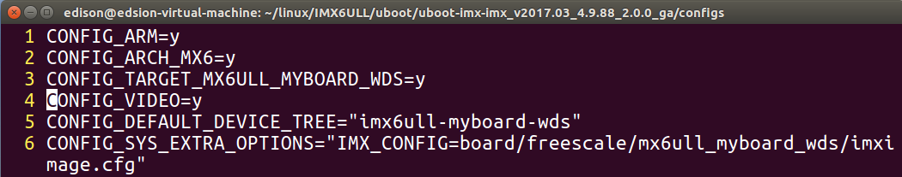
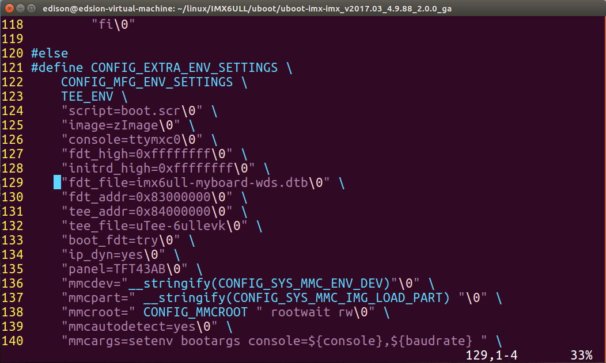
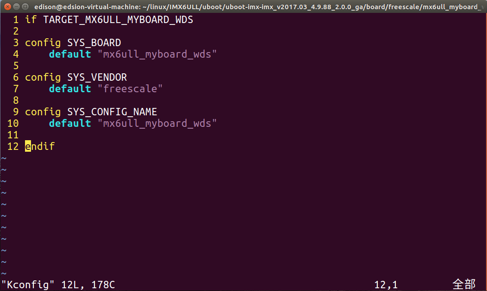
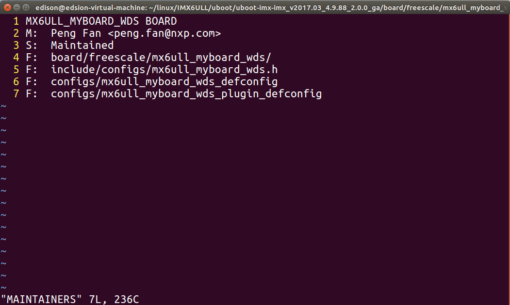
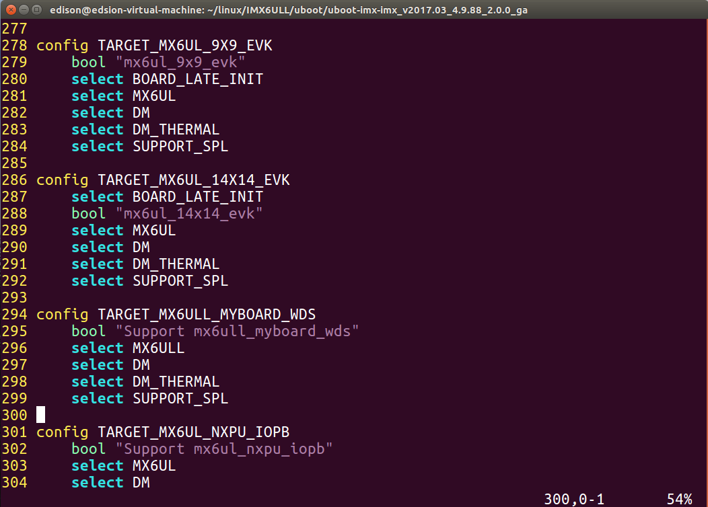
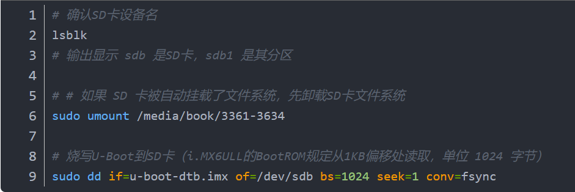

# U-Boot 2017.03 移植流程（100ASK IMX6ULL Pro / mx6ull_myboard_wds）

> 平台：百问网 100ASK IMX6ULL Pro（NXP i.MX6ULL，Cortex-A7，512MB DDR3，4GB eMMC）
> 源码：NXP `uboot-imx`，分支 `imx_v2017.03_4.9.88_2.0.0_ga`（U-Boot 2017.03）
> 源码包：`uboot/sources/uboot-imx-imx_v2017.03_4.9.88_2.0.0_ga.zip`（解压后使用，详见 `uboot/sources/README.md`）
> 板级名：`mx6ull_myboard_wds`（本文与 `configs/` 统一用这个命名）
> 参考：上游仓库 <https://github.com/illusOwo-ff/i.MX6ULL-bsp-driver-project>

全文按"做什么、为什么、怎么做、怎么验证"四步走，末尾附上踩坑记录和改动文件清单。文里的配置项、文件路径都跟源码树对得上，可以边看边敲。

---

## 0. 说明

### 0.1 命名约定

| 对象 | 本项目的名字 | 说明 |
|------|-------------|------|
| 板级配置 | `mx6ull_myboard_wds_defconfig` | 由 `mx6ull_14x14_evk_defconfig` 复制改名 |
| 板级头文件 | `include/configs/mx6ull_myboard_wds.h` | 由 `mx6ullevk.h` 复制改名 |
| 板级目录 | `board/freescale/mx6ull_myboard_wds/` | 由 `board/freescale/mx6ullevk/` 复制改名 |
| 设备树 | `arch/arm/dts/imx6ull-myboard-wds.dts` | 由 `imx6ull-14x14-evk.dts` 复制改名 |
| Kconfig 符号 | `TARGET_MX6ULL_BOARD_WDS` | 在 `arch/arm/cpu/armv7/mx6/Kconfig` 注册 |
| 板级宏 | `CONFIG_TARGET_MX6ULL_BOARD_WDS` | 与上面的 Kconfig 符号对应 |

> 上游参考仓库那边叫 `mx6ull_myboard`（头文件是 `mx6ull_myboard.h`），流程跟本文一模一样，只是名字不同。两边对照着看，按上表替换一下就行。

### 0.2 与其他文档的关系

- 内核移植：`kernel/README.md`
- 根文件系统与 eMMC 部署、U-Boot 启动参数（`ext2load`、分区 2 等）：`rootfs/docs/rootfs_build_guide.md` 第 5 章
- 本目录结构：

```
uboot/
├── README.md                        # 模块说明
├── configs/
│   └── mx6ull_myboard_wds_defconfig # 板级 defconfig（复制到源码树 configs/）
├── docs/
│   ├── uboot_porting_guide.md       # 本文：完整移植流程 + 踩坑记录
│   └── images/                      # 移植过程截图 01~06（本文各章节引用）
│       ├── 01-defconfig.png
│       ├── 02-fdt-file.png
│       ├── 03-board-kconfig.png
│       ├── 04-maintainers.png
│       ├── 05-soc-kconfig.png
│       └── 06-build-and-burn.png
└── sources/
    ├── README.md                                   # 源码包说明、解压与校验
    └── uboot-imx-imx_v2017.03_4.9.88_2.0.0_ga.zip  # U-Boot 2017.03 源码包（23.2 MB）
```

---

## 1. 移植的思路与流程

### 1.1 移植到底在做什么

先破个误区：U-Boot 移植不是让你从头写一个 bootloader。这活儿芯片原厂早就干完了——NXP 把自己的参考板（EVK）伺候得明明白白，SoC 初始化、DDR 参数、时钟树、串口、存储驱动，一股脑全塞进了 BSP 包。

我们要干的其实只有一件：把自己的板子和参考板摆一块儿，找出硬件上不一样的地方，改对应的代码。听着简单，拆开也就三步：

1. 读原厂参考板的代码，搞清楚"人家原来是怎么做的"；
2. 对照原理图，找出"我的板和它差在哪儿"；
3. 只改有差异的那部分，别的一概不碰。

### 1.2 完整流程

```
获取 NXP BSP 源码（2017.03 / 4.9.88 分支）
        ↓
用 EVK 的 defconfig 编译，烧到 SD 卡启动
        ↓
在 U-Boot 命令行检查 DDR / SD / eMMC / 串口 / 网络
        ↓
添加自己的板子（复制 defconfig、头文件、板级目录、设备树并改名）
        ↓
对比原理图，逐项适配硬件差异（网络 PHY、LCD 等）
        ↓
编译、烧写、测试、排错
        ↓
验证：能 ping 通、能 bootz 启动内核
```

**为什么先拿 EVK 的配置开刀**：这套配置在 NXP 自家板子上跑过无数遍，可信。先确认 DDR、串口、存储都没事，就等于把"SoC 级的问题"一次性排除干净；往后要是再出岔子，不用怀疑，十有八九是板级差异。

---

## 2. 环境与源码

### 2.1 确认版本

版本怎么定？最省事的办法，是看开发板原厂 U-Boot 启动时打的那一行：

```
U-Boot 2017.03 (Jun 03 2020 - 13:12:42 +0800)
```

再结合内核 4.9.88，分支基本就锁死了：`imx_v2017.03_4.9.88_2.0.0_ga`。NXP 这套命名规则是 `imx_v{U-Boot 版本}_{内核版本}_{BSP 版本}`，尾巴上的 `ga` 是正式发布的意思。

### 2.2 获取源码

源仓库：<https://github.com/nxp-imx/uboot-imx>（分支 `imx_v2017.03_4.9.88_2.0.0_ga`：U-Boot 2017.03、适配 4.9.88 内核）

最省事的当然是直接 clone：

```bash
git clone -b imx_v2017.03_4.9.88_2.0.0_ga --single-branch \
    https://github.com/nxp-imx/uboot-imx.git
cd uboot-imx

git log --oneline -1                  # 确认在 imx_v2017.03_4.9.88_2.0.0_ga 上
ls configs | grep mx6ull              # 应能看到 mx6ull_14x14_evk_defconfig
```

**另一种方式（防呆）**：仓库里另存了一份同分支的 ZIP——`uboot/sources/uboot-imx-imx_v2017.03_4.9.88_2.0.0_ga.zip`（23.2 MB）。离线、网络受限或 clone 失败时，直接解压即可：

```bash
cd <仓库>/uboot/sources
unzip -q uboot-imx-imx_v2017.03_4.9.88_2.0.0_ga.zip
cd uboot-imx-imx_v2017.03_4.9.88_2.0.0_ga
```

两种方式弄出来的源码一模一样，挑一个顺手的就行。差别只在版本控制：clone 下来的自带 `.git`，`git diff` 一下就能出补丁；ZIP 解压的没有，想用 diff 得先 `git init && git add -A && git commit` 补一套（细节见 `uboot/sources/README.md`）。

> 下文命令都拿 ZIP 解压出来的 `uboot-imx-imx_v2017.03_4.9.88_2.0.0_ga` 当例子；你要是用 clone，把目录名换成 `uboot-imx` 即可。
> 两条版本信息认准了：U-Boot 2017.03、内核 4.9.88。

### 2.3 工具链

```bash
arm-linux-gnueabihf-gcc -v      # 本项目：GCC 4.9.4（Linaro 2017.01）
```

**为什么反复强调这个**：U-Boot、内核、rootfs 必须同一套工具链。不一致的时候，U-Boot 照样编得过，内核也照样起得来，偏偏 rootfs 的 init 会因为 glibc/ABI 对不上直接罢工（`No working init found`）。这错最难查的地方在于，报错的位置离病因十万八千里。

> 上游文档里写的是"Buildroot 2020.02 自带的 gcc 7.5.0"，本项目实际用 4.9.4。版本新旧不要紧，三者一致才要紧。

---

## 3. 首次编译：用 EVK 配置验证 SoC

### 3.1 选 defconfig

```bash
cd uboot-imx-imx_v2017.03_4.9.88_2.0.0_ga
ls configs | grep mx6ull
# mx6ull_14x14_evk_defconfig
```

为什么选它？一样是 i.MX6ULL，EVK 跟本板的硬件最接近；更关键的是，原厂那版 U-Boot 本来就是拿它改出来的。

### 3.2 编译

```bash
make distclean
make mx6ull_14x14_evk_defconfig
make -j$(nproc)
```

编出来一堆文件，真正要烧到卡上的只有 `u-boot-dtb.imx`。为什么是它，4.6 节的产物表里说。

### 3.3 烧到 SD 卡

**开发阶段一律用 SD 卡**：eMMC 里那套原厂系统别碰，卡一拔，板子还是出厂状态，怎么折腾都有退路。

```bash
lsblk                                  # 确认 SD 卡设备名，例如 sdb
sudo umount /media/$USER/XXXX          # 若被自动挂载，先卸载
sudo dd if=u-boot-dtb.imx of=/dev/sdb bs=1024 seek=1 conv=fsync
```

三个细节，一个都不能错：

| 细节 | 说明 |
|------|------|
| `of=/dev/sdb` 是**整盘** | 不是 `/dev/sdb1`。写分区会破坏分区表 |
| `seek=1` × `bs=1024` | i.MX6ULL 的 BootROM 从 **0x400（1024 字节）** 处读 IVT，所以必须偏移 1KB |
| `conv=fsync` | 保证数据落盘再拔卡，否则可能只写了一半 |

### 3.4 启动检查

拨码开关拨到 SD 卡启动，串口该出东西了：

```
U-Boot 2017.03 (Apr 12 2026 - 01:41:12 -0400)
CPU:   Freescale i.MX6ULL rev1.1 696 MHz (running at 396 MHz)
DRAM:  512 MiB
MMC:   FSL_SDHC: 0, FSL_SDHC: 1
In:    serial
Out:   serial
Err:   serial
Net:   No ethernet found.
```

进了命令行，先摸摸底，两个存储设备都点名一遍：

```bash
=> mmc dev 0      # SD 卡
=> mmc info
=> mmc dev 1      # eMMC
=> mmc info
```

逐项对一下，情况一目了然：

| 功能 | 状态 | 说明 |
|------|------|------|
| DDR | 正常 | 512 MiB，说明 DDR 初始化正确 |
| SD / eMMC | 正常 | `mmc info` 能读到容量 |
| 串口 | 正常 | 可交互 |
| LCD | 不正常 | 默认 480x272，与实屏不符；本项目不涉及 LCD，暂不处理 |
| 网络 | **不正常** | `No ethernet found`，需要移植 |

结论很清楚：SoC 这一层没毛病，唯一的窟窿是网络。而网络，恰恰就是板级 PHY 的差异。

---

## 4. 添加自己的板子

### 4.1 复制四类文件

新板子的骨架，就是把 EVK 的四样东西复制一份、换个名：

| 对象 | 源 | 目标 |
|------|----|------|
| defconfig | `configs/mx6ull_14x14_evk_defconfig` | `configs/mx6ull_myboard_wds_defconfig` |
| 头文件 | `include/configs/mx6ullevk.h` | `include/configs/mx6ull_myboard_wds.h` |
| 板级目录 | `board/freescale/mx6ullevk/` | `board/freescale/mx6ull_myboard_wds/` |
| 设备树 | `arch/arm/dts/imx6ull-14x14-evk.dts` | `arch/arm/dts/imx6ull-myboard-wds.dts` |

```bash
cd uboot-imx-imx_v2017.03_4.9.88_2.0.0_ga

cp configs/mx6ull_14x14_evk_defconfig         configs/mx6ull_myboard_wds_defconfig
cp include/configs/mx6ullevk.h                include/configs/mx6ull_myboard_wds.h
cp -r board/freescale/mx6ullevk               board/freescale/mx6ull_myboard_wds
cp arch/arm/dts/imx6ull-14x14-evk.dts         arch/arm/dts/imx6ull-myboard-wds.dts
```

### 4.2 defconfig：改 3 处

```diff
-CONFIG_TARGET_MX6ULL_14X14_EVK=y
+CONFIG_TARGET_MX6ULL_BOARD_WDS=y

-CONFIG_DEFAULT_DEVICE_TREE="imx6ull-14x14-evk"
+CONFIG_DEFAULT_DEVICE_TREE="imx6ull-myboard-wds"

-CONFIG_SYS_EXTRA_OPTIONS="IMX_CONFIG=board/freescale/mx6ullevk/imximage.cfg"
+CONFIG_SYS_EXTRA_OPTIONS="IMX_CONFIG=board/freescale/mx6ull_myboard_wds/imximage.cfg"
```



别小看这三行，每一行都牵着一条线：`CONFIG_TARGET_*` 决定编译哪个板级目录、链接哪个头文件；`CONFIG_DEFAULT_DEVICE_TREE` 决定内置哪棵设备树；`IMX_CONFIG` 决定生成 `u-boot-dtb.imx` 时用哪份 `imximage.cfg`（DCD/IVT 配置）。

### 4.3 头文件：宏守卫与 dtb 名

```c
/* 1. 头文件守卫（不强制，但不改会与 EVK 混淆） */
#ifndef __MX6ULL_MYBOARD_WDS_CONFIG_H
#define __MX6ULL_MYBOARD_WDS_CONFIG_H
```

```c
/* 2. 环境变量里的设备树文件名 */
"fdt_file=imx6ull-myboard-wds.dtb\0" \
```



**道理不难懂**：`fdt_file` 是 `loadfdt` 默认去加载的 dtb 名字。不改它，U-Boot 转头就去加载 EVK 的 dtb，症状是"内核起来了，设备树却不对"，查起来相当费劲。

### 4.4 板级目录：5 处小改

```bash
cd board/freescale/mx6ull_myboard_wds
mv mx6ullevk.c mx6ull_myboard_wds.c
```

| 文件 | 改什么 |
|------|--------|
| `Makefile` | `obj-y := mx6ull_myboard_wds.o`（不改就编不到你的 .c） |
| `imximage.cfg` | `PLUGIN board/freescale/mx6ull_myboard_wds/plugin.bin 0x00907000` |
| `Kconfig` | `config TARGET_MX6ULL_BOARD_WDS` + 引用新的头文件名 |
| `MAINTAINERS` | 板子条目、文件路径 |
| `mx6ull_myboard_wds.c` | `checkboard()` 里的打印名（可选） |





**为什么这几处不能漏**：`imximage.cfg` 里的 `PLUGIN` 行指向 `plugin.bin`，路径写错，`mkimage` 打包时就找不到插件；`Kconfig` 不改，新板子在 `make menuconfig` 里连影子都看不见。

### 4.5 SoC Kconfig：注册新板

`arch/arm/cpu/armv7/mx6/Kconfig`，先加 config 条目：

```kconfig
config TARGET_MX6ULL_BOARD_WDS
	bool "Support mx6ull_myboard_wds"
	select MX6ULL
	select DM
	select DM_THERMAL
```

再在文件末尾 `endif` 之前加：

```kconfig
source "board/freescale/mx6ull_myboard_wds/Kconfig"
```



**这一步的道理**：`configs/mx6ull_myboard_wds_defconfig` 里的 `CONFIG_TARGET_MX6ULL_BOARD_WDS=y`，必须在 Kconfig 里找得到定义。找不到，`make defconfig` 就提示符号不存在，板级目录也不会被编进去。

### 4.6 编译脚本与产物

在源码根目录建 `mx6ull_myboard_wds.sh`：

```bash
#!/bin/bash
make ARCH=arm CROSS_COMPILE=arm-linux-gnueabihf- distclean
make ARCH=arm CROSS_COMPILE=arm-linux-gnueabihf- mx6ull_myboard_wds_defconfig
make V=1 ARCH=arm CROSS_COMPILE=arm-linux-gnueabihf- -j16
```

> 顺带一提，原笔记里 `ARCH=armCROSS_COMPILE=...` 中间少了个空格。看着差不多，跑起来 `ARCH` 的值就错了，这里已经改过来。

产物区别：

| 文件 | 内容 | 用途 |
|------|------|------|
| `u-boot.bin` | 纯 U-Boot | 调试用 |
| `u-boot.dtb` | 纯设备树 | 调试用 |
| `u-boot-dtb.bin` | U-Boot + 设备树 | 调试用 |
| `u-boot-dtb.imx` | U-Boot + 设备树 + IVT/DCD 头 | **烧录用** |

烧写（同 3.3）：

```bash
sudo dd if=u-boot-dtb.imx of=/dev/sdb bs=1024 seek=1 conv=fsync
```



**为什么只偏移 1KB 就够了**：i.MX6ULL 的 BootROM 是个死脑筋，认准了从存储介质的 0x400（1024 字节）处读 IVT（Image Vector Table），再由 IVT 去指 DCD（DDR 初始化）和 U-Boot 本体。`u-boot-dtb.imx` 早把这颗头拼好了，所以直接 dd 到 1KB 处就完事。

### 4.7 编译验证

```bash
./mx6ull_myboard_wds.sh
```

只要编得过、起得来，"加板子"这一步就算成了。当然，这会儿它的本事跟 EVK 一模一样，网络照样亮红灯。

---

## 5. 网络移植（本板与 EVK 的核心差异）

### 5.1 差异从哪来

网络这事得拆成两层看：

- **SoC 内部的 MAC（FEC）**：原厂驱动已适配，不用改；
- **板上的 PHY 芯片**：通过 RMII 与 MAC 相连，数据线是标准的，但**复位引脚、PHY 地址**由板子硬件决定。

| 差异项 | NXP EVK | 本板（100ASK） |
|--------|---------|----------------|
| PHY 芯片 | KSZ8081（Micrel） | LAN8720A（SMSC） |
| ENET1 PHY 地址 | 0x2 | **0x0**（PHYAD0 下拉） |
| ENET2 PHY 地址 | 0x1 | 0x1（一致，不改） |
| PHY 复位方式 | 74HC595 扩展 GPIO | SoC GPIO 直连 |
| ENET1 复位脚 | 74HC595 | `SNVS_TAMPER9` = GPIO5_IO09 |
| ENET2 复位脚 | 74HC595 | `SNVS_TAMPER6` = GPIO5_IO06 |

**PHY 地址怎么确认**：去原理图上找 PHY 的 PHYAD0 脚，看它上下拉。LAN8720A 就这一个地址脚：复位时接地就是地址 0，上拉就是地址 1，没有第三种可能。

### 5.2 头文件三处

```c
/* 1. PHY 驱动：KSZ8081 → LAN8720A */
#define CONFIG_PHY_SMSC

/* 2. ENET1 的 PHY 地址 */
#define CONFIG_FEC_MXC_PHYADDR          0x0

/* 3. DM_ETH 要求有 MAC 地址，加到 CONFIG_EXTRA_ENV_SETTINGS */
"ethaddr=00:04:9f:04:d2:35\0" \
"eth1addr=00:04:9f:04:d2:36\0" \
"ipaddr=192.168.1.6\0" \
"serverip=192.168.1.7\0" \
```

**为什么非设 `ethaddr` 不可**：2017 版 U-Boot 启用了 DM_ETH（设备模型），没有 MAC 地址，网络设备连 probe 都不肯，ping 直接甩你一句 `Error: ethernet@020b4000 address not set`。2016 版没这套要求——这是版本差异，不是你配错了，别在这儿怀疑人生。

### 5.3 板级 C 文件：PHY 硬件复位

`setup_fec()` 管 FEC 的时钟和初始化。原厂代码里没有 PHY 复位这一步，因为 EVK 靠 74HC595 代劳了；本板没这个待遇，只能自己动手拉复位脚：

```c
#define ENET1_RESET_GPIO    IMX_GPIO_NR(5, 9)
#define ENET2_RESET_GPIO    IMX_GPIO_NR(5, 6)

/* 放在 enable_enet_clk(1); 之后 */
if (fec_id == 0) {
    gpio_request(ENET1_RESET_GPIO, "enet1_reset");
    gpio_direction_output(ENET1_RESET_GPIO, 0);
    mdelay(20);                                  /* 拉低 ≥ 20ms */
    gpio_direction_output(ENET1_RESET_GPIO, 1);
    mdelay(100);                                 /* 复位后等 100ms */
} else {
    gpio_request(ENET2_RESET_GPIO, "enet2_reset");
    gpio_direction_output(ENET2_RESET_GPIO, 0);
    mdelay(20);
    gpio_direction_output(ENET2_RESET_GPIO, 1);
    mdelay(100);
}
```

同时删除 `board_phy_config()` 里这行 KSZ8081 专用寄存器写：

```c
phy_write(phydev, MDIO_DEVAD_NONE, 0x1f, 0x8190);
```

**为什么**：LAN8720A 这芯片有点小脾气，上电时 RST 上的复位时序不完整，它就可能赖着不进工作状态。症状是 `mdio list` 空空如也，PHY 怎么都扫不到。`fec_id == 0` 走 ENET1（核心板 U6），`else` 走 ENET2（底板 U11），别接反了。

### 5.4 PHY 驱动：LAN8720A 软复位

`drivers/net/phy/phy.c` 的 `genphy_update_link()` 开头：

```c
#ifdef CONFIG_PHY_SMSC
    static int lan8720_flag = 0;
    int bmcr_reg = 0;
    if (lan8720_flag == 0) {
        bmcr_reg = phy_read(phydev, MDIO_DEVAD_NONE, MII_BMCR);
        phy_write(phydev, MDIO_DEVAD_NONE, MII_BMCR, BMCR_RESET);
        while (phy_read(phydev, MDIO_DEVAD_NONE, MII_BMCR) & 0X8000) {
            udelay(100);
        }
        phy_write(phydev, MDIO_DEVAD_NONE, MII_BMCR, bmcr_reg);
        lan8720_flag = 1;
    }
#endif
```

**为什么**：LAN8720A 头一回协商链路，偶尔会"自说自话"——自协商明明完成了，链路实际不通。办法是在第一次读链路状态之前，通过 BMCR 的 RESET 位来一次软复位，再把原来的 BMCR 值写回去。只干一次，所以拿 `static` 当开关。

### 5.5 设备树：PHY 地址

```dts
ethphy0: ethernet-phy@0 {
    reg = <0>;
};
```

**两边必须对上**：设备树的 `reg` 和头文件里的 `CONFIG_FEC_MXC_PHYADDR` 必须一致，否则 MAC 跑去 MDIO 上敲错门。

### 5.6 Kconfig：最容易漏的一步

做完上面的代码修改，编译烧写，满心欢喜上电——**网络还是不工作**。这时候别急着怀疑人生，先查这个：

```bash
grep -E "PHYLIB|PHY_SMSC|FEC_MXC" .config
# 可能显示 # CONFIG_PHYLIB is not set
```

**原因**：2017.03 这会儿正卡在配置系统的过渡期，一部分 `CONFIG_*` 已经被 Kconfig 接管了，而且**Kconfig 说话比头文件里的 `#define` 管用**。

**处理**：`make menuconfig` 打开：

```
Device Drivers →
    [*] Ethernet PHY (physical media interface) support
        [*] SMSC PHY support
    [*] Network device support
        [*] FEC Ethernet controller
```

选中 FEC 后会提示填 MDIO 基地址，填 `0x020B4000`（ENET2_BASE_ADDR）。

配置只活在 `.config` 里，`make distclean` 一扫就没了，所以必须固化回 defconfig：

```bash
make savedefconfig
cp defconfig configs/mx6ull_myboard_wds_defconfig
```

**为什么**：`savedefconfig` 只留跟默认值不一样的那些项，文件小、也干净。不固化的话，下次 `distclean + defconfig` 一跑，网络配置又蒸发，症状就是那句经典的"昨天还好好的，今天怎么就 No ethernet found 了"。

---

## 6. 验证

### 6.1 网络

网络通没通，一条 `ping` 最直接；顺手再 `mdio list`，看看 PHY 认没认出来：

```bash
=> ping 192.168.1.7
ethernet@020b4000 Waiting for PHY auto negotiation to complete.... done
Using ethernet@020b4000 device
host 192.168.1.7 is alive

=> mdio list
FEC1:
1 - SMSC LAN8710/LAN8720 <--> ethernet@020b4000
```

`mdio list` 里能看见 LAN8720A，就说明 MAC 到 PHY 的 MDIO 通路是通的，PHY 驱动也上班了。

另外有两个点特别容易误判，提前打个预防针：

- 启动时 `Net: No ethernet found` **不代表网络不可用**：DM_ETH 懒加载，只有真正用网络命令时才 probe。`dm tree` 里 `eth` 设备显示未 probe 是正常的。
- 只列出一个 PHY：`CONFIG_FEC_ENET_DEV=1` 表示当前只初始化 ENET2；要测 ENET1 改成 0 重编。

### 6.2 启动内核（移植的最终验证）

这会儿 SD 卡里就一个 U-Boot，内核和设备树都没有，那就先从 eMMC 里借原厂系统来跑：

```bash
=> mmc dev 1
=> ls mmc 1:2 /boot
    39327 100ask_imx6ull-14x14.dtb
  7924872 zImage

=> ext2load mmc 1:2 0x80800000 /boot/zImage
=> ext2load mmc 1:2 0x83000000 /boot/100ask_imx6ull-14x14.dtb
=> setenv bootargs 'console=ttymxc0,115200 root=/dev/mmcblk1p2 rootwait rw'
=> bootz 0x80800000 - 0x83000000
```

看着内核一行行刷过去、最后掉进 Linux shell，U-Boot 这一关就算过了。

### 6.3 固化到 eMMC 的 4 处修改

等你要改成"从 eMMC 分区 2 加载内核和 dtb"的时候，`include/configs/mx6ull_myboard_wds.h` 里还有 4 处得跟着动：

| 变量 | 改为 |
|------|------|
| `CONFIG_SYS_MMC_IMG_LOAD_PART` | `2` |
| `fdt_file` | `imx6ull-my14x14-emmc.dtb`（内核编出的 dtb） |
| `loadimage` | `ext2load mmc ${mmcdev}:${mmcpart} ${loadaddr} /boot/${image}` |
| `loadfdt` | `ext2load mmc ${mmcdev}:${mmcpart} ${fdt_addr} /boot/${fdt_file}` |

原因与验证见 `rootfs/docs/rootfs_build_guide.md` 第 5 章。

---

## 7. 踩坑记录

### 7.1 Kconfig 覆盖头文件（最大坑）

**现象**：头文件里 `#define CONFIG_PHYLIB`、`#define CONFIG_PHY_SMSC`、`#define CONFIG_FEC_MXC` 写得明明白白，`.config` 里却一个个 `not set`，网络纹丝不动。

**原因**：2017.03 正好卡在配置系统的过渡期，这几个符号已经归 Kconfig 管了，头文件里的 `#define` 说了不算。

**处理**：`make menuconfig` 使能 PHYLIB / PHY_SMSC / FEC_MXC，`make savedefconfig` 固化。

**经验**：碰上"明明定义了却不生效"，第一步别猜，`grep xxx .config` 看它的真实值。

### 7.2 DM_ETH 要求 MAC 地址

**现象**：ping 报 `Error: ethernet@020b4000 address not set`。

**原因**：DM_ETH 框架要求环境变量有 `ethaddr`。

**处理**：头文件 `CONFIG_EXTRA_ENV_SETTINGS` 里加 `ethaddr`/`eth1addr`。

### 7.3 缺 PHY 硬件复位 → `mdio list` 为空

**现象**：配置看着全对，MDIO 上就是找不到 PHY。

**原因**：EVK 用 74HC595 控制复位，本板是 GPIO 直连，原厂代码里根本没写复位动作。

**处理**：在 `setup_fec()` 里补一段 GPIO 复位：拉低 20ms，拉高，再等 100ms。

### 7.4 `No ethernet found` 是假警报

**现象**：启动日志白纸黑字写着 `Net: No ethernet found`，可 `ping` 偏偏能通。

**原因**：DM_ETH 是懒加载的，启动阶段只注册、不 probe，真到了用网络命令时才动手。所以这行日志是假警报。

**验证**：`dm tree` 看 `eth` 节点是否已注册；直接用 `ping` 测。

### 7.5 只识别一个网口

**现象**：`mdio list` 只有 FEC1。

**原因**：`CONFIG_FEC_ENET_DEV=1` 明说了只用 ENET2，`setup_fec` 当然只伺候一个。

**处理**：要测 ENET1，把该宏改成 0 重编（两路的 PHY 地址、复位 GPIO 代码都已经备好了）。

### 7.6 改名遗漏导致"编过了但不生效"

**现象**：编译一路绿灯，烧进去却还是 EVK 的脾气——dtb 名不对、插件路径错、板名也不对。

**原因**：`defconfig` 的 `CONFIG_DEFAULT_DEVICE_TREE` / `CONFIG_SYS_EXTRA_OPTIONS`、板级 `Makefile` 的 `obj-y`、`imximage.cfg` 的 `PLUGIN`、`Kconfig` 的 source、`arch/arm/dts/Makefile` 的条目，漏一个就会出现"能启动但不对"。

**经验**：改完名，全局 `grep -rn "mx6ullevk" .` 扫一遍，确认没漏网之鱼。

### 7.7 dd 写错设备

**现象**：烧完起不来，或者 SD 卡的分区表直接报废。

**原因**：`of=` 写成了 `/dev/sdb1`（分区），或者 `seek` 写成了 0。

**处理**：`of=` 用整盘设备，`bs=1024 seek=1`，写完 `sync` 再拔卡。

### 7.8 工具链版本不一致

**现象**：U-Boot 和内核都好好的，偏偏 rootfs 起不来（`No working init found`）。

**原因**：rootfs 是另一套工具链编的，glibc 版本跟内核的预期对不上。

**处理**：三个组件统一用 `gcc-linaro-4.9.4-2017.01`。

---

## 8. 修改文件汇总

| 文件 | 修改内容 |
|------|---------|
| `configs/mx6ull_myboard_wds_defconfig` | 目标名、设备树名、IMX_CONFIG；PHYLIB/PHY_SMSC/FEC_MXC/MDIO 基地址 |
| `include/configs/mx6ull_myboard_wds.h` | 守卫名；`CONFIG_PHY_SMSC`；PHY 地址 0x0；默认 MAC/IP；`fdt_file`；eMMC 启动 4 处 |
| `board/freescale/mx6ull_myboard_wds/mx6ull_myboard_wds.c` | 新增 PHY 复位 GPIO；删除 KSZ8081 寄存器写；板名打印 |
| `board/freescale/mx6ull_myboard_wds/Makefile` | `obj-y := mx6ull_myboard_wds.o` |
| `board/freescale/mx6ull_myboard_wds/imximage.cfg` | `PLUGIN` 路径 |
| `board/freescale/mx6ull_myboard_wds/Kconfig` | 板级 config 与头文件引用 |
| `board/freescale/mx6ull_myboard_wds/MAINTAINERS` | 板子条目 |
| `arch/arm/cpu/armv7/mx6/Kconfig` | 新增 `TARGET_MX6ULL_BOARD_WDS` 与 `source` |
| `arch/arm/dts/imx6ull-myboard-wds.dts` | ENET1 PHY `reg = <0>` |
| `arch/arm/dts/Makefile` | 新增 dtb 编译条目 |
| `drivers/net/phy/phy.c` | LAN8720A 软复位 |

数了数，改动集中在 10 个文件里。要归档，`git diff` 导成补丁就完事。

---

## 9. 附录

### A. 命令速查

```bash
# 编译
make distclean
make mx6ull_myboard_wds_defconfig
make -j$(nproc) V=1

# 查看配置是否生效
grep -E "PHYLIB|PHY_SMSC|FEC_MXC|TARGET_MX6ULL" .config

# 固化配置
make savedefconfig && cp defconfig configs/mx6ull_myboard_wds_defconfig

# 烧写 SD
lsblk
sudo dd if=u-boot-dtb.imx of=/dev/sdb bs=1024 seek=1 conv=fsync

# U-Boot 内验证
mmc dev 0 && mmc info
mmc dev 1 && mmc info
ping 192.168.1.7
mdio list
dm tree
```

### B. 与本仓库文件的对应关系

| 文件 | 内容 |
|------|------|
| `uboot/configs/mx6ull_myboard_wds_defconfig` | 最终板级配置（复制到源码树 `configs/`） |
| `uboot/docs/images/` | 移植过程截图（6 张） |
| `uboot/sources/uboot-imx-imx_v2017.03_4.9.88_2.0.0_ga.zip` | U-Boot 2017.03 源码包（解压后使用） |
| `uboot/sources/README.md` | 源码包说明、解压方式与校验记录 |

### C. 关键结论

1. **移植就是改差异**，别想着重写；先让 EVK 的配置跑通，再碰板级。
2. **改名要成套**：defconfig、头文件、板级目录、设备树、Kconfig、dts Makefile，缺一不可。
3. **2017.03 里 Kconfig 比头文件大**，网络三件套必须在 menuconfig 里开。
4. **PHY 地址和复位**是本板跟 EVK 的主要差异：地址去原理图上找，复位写进 `setup_fec`。
5. **验证分两级**：`ping` 通了，说明网络可用；`bootz` 起内核了，移植才算完成。

> 题外话：头一回做 U-Boot 移植，八成人会在 `No ethernet found` 和 `mdio list` 之间来回打转，改了半天还在原地。别急，这一关几乎人人都要过。等 `ping` 真通了，回头看改动其实就那几行——那种"折腾一晚上，终于清净了"的感觉，还挺值。
